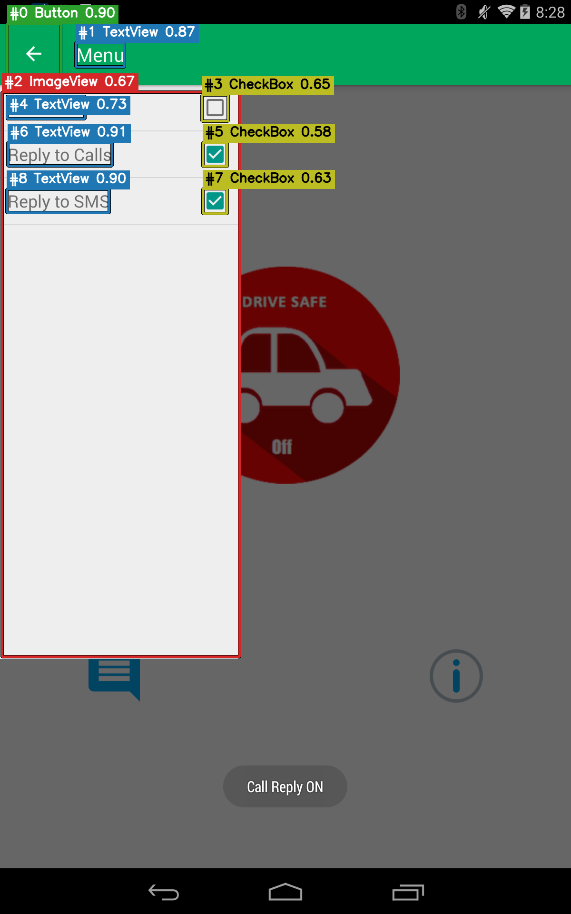

# ui2compose

[](https://github.com/gbilgeturk/ui2compose/actions/workflows/ci.yml)

**Automatic generation of Jetpack Compose UI code from Android screen designs.**

`ui2compose` takes a screenshot (or design mockup) of an Android screen and produces
[Jetpack Compose](https://developer.android.com/compose) code. A YOLO-based UI
component detector is followed by rule-based stages whose every decision is recorded,
so that the position of each component in the generated code can be traced back to
the rule and the coordinates that produced it:

```
Screenshot ─► 1. Detection (YOLOv8s) ─► 2. De-duplication ─► 3. UI graph (containment)
           ─► 4. Layout (composites + XY-cut) and code templates ─► GeneratedScreen.kt
```

Pretrained weights are included in the repository, so inference works out of the box — no
training required. The default is `runs/oversample_5k_appsplit/weights/best.pt` (22 MB),
YOLOv8s trained on an app-level split of ReDraw, so that its test results refer to apps it
has never seen. `runs/oversample_5k/weights/best.pt` is the checkpoint of the v1.1.0
release (screenshot-level split), kept to reproduce the numbers reported for v1.1.0
(see [Model](#model)).

## How it works

1. **Detection.** A YOLOv8s model trained on the [ReDraw](https://zenodo.org/records/2530277)
   dataset finds components of 13 Android classes (`Button`, `CheckBox`, `EditText`,
   `ImageView`, `ListView`, `ProgressBar`, `RadioButton`, `RecyclerView`, `SeekBar`,
   `Spinner`, `Switch`, `TextView`, `WebView`). Detections have ids 0..n-1 in top-to-bottom
   order; no later stage renumbers them, so an id can be followed through every output file.
2. **De-duplication** (`infer/postprocess.py`). The detector's NMS is class-aware, so the
   same element can survive twice. Three explicit rules remove the lower-confidence box of a
   pair: same class with IoU ≥ 0.4; same class, for classes that cannot contain themselves
   (e.g. `TextView`, `Button`), with intersection / smaller area ≥ 0.85; different classes with
   IoU ≥ 0.5. Every removal is written to `1_dedup_removed.json` with its rule, overlap value
   and the id of the box that caused it. An optional per-class confidence filter
   (`class_conf`, off by default) runs before it.
3. **UI graph** (`infer/build_ui_graph.py`). A box B is *contained* in box A when at least
   90 % of B's area lies in A and A ranks above B (larger area, then higher confidence, then
   lower id). Each box gets **one** parent: the smallest box containing it. The result is a
   forest in which every detection occurs exactly once, also when boxes overlap partly
   (v1.1.0 listed a child of two overlapping parents twice). The graph also contains
   spatial edges (`above` / `below` / `left_of` / `right_of` between boxes with the same
   parent, aligned within 20/1200 of the image width) and synthetic row/column groups.
   **The spatial edges and the synthetic groups are an inspection export (graph and
   adjacency views of the demo); code generation does not read them** — a test checks that
   removing or shuffling them leaves the Kotlin byte-identical.
4. **Layout and code** (`infer/generate_compose_code.py`). Code generation reads only the
   containment forest:
   * a `ListView` / `RecyclerView` with detected children becomes a `LazyColumn` with one
     `item { }` per vertical group of its children; any other box with children becomes a
     `Box { <its own widget>; <its children's layout> }`;
   * the boxes of each level are grouped by recursive **XY-cut**: a horizontal cut (→
     `Column`) or vertical cut (→ `Row`) is allowed where the boxes on both sides are
     separated by a gap, or overlap by less than `cut_tol_frac` of the image height (width);
     the default `cut_tol_frac` is 0, i.e. a cut needs a gap (touching boxes may be cut), as
     in v1.1.0; axes alternate, y first;
   * where boxes overlap so that no cut exists on either axis, a **fallback** orders them:
     `y_sorted` (default, the v1.1.0 behaviour: a `Column` ordered by y-centre) or
     `least_overlap` (split where the summed overlap is smallest). The fallback is recorded
     in the layout tree, so it is visible in every trace;
   * every leaf is written with a fixed template for its class; all 13 classes have one
     (e.g. `SeekBar` → `Slider`, `Spinner` → `OutlinedButton` + `DropdownMenu`, `WebView` →
     `AndroidView`). Texts, images and states are placeholders: only the component types and
     the layout structure come from the screenshot;
   * every detection that reaches this stage appears in the Kotlin exactly once.

   `--layout flat` is a baseline that ignores containment and stacks all detections in one
   `Column` ordered by y-centre.

All thresholds are named parameters and are **relative** to the image size (or
size-independent ratios), so the same screen at another resolution gives the same graph and
layout. Their defaults:

| Stage | Parameter | Default | Status |
|---|---|---|---|
| Detection | `conf_threshold` / NMS `iou_threshold` / `imgsz` | 0.3 / 0.7 / the checkpoint's (640) | settings v1.1.0 ran with |
| De-duplication | `same_class_iou` / `same_class_iomin` / `cross_class_iou` | 0.4 / 0.85 / 0.5 | selected on val (a priori 0.5 / 0.9 / 0.6) |
| UI graph | `containment_ratio` | 0.9 | selected on val (a priori 0.95) |
| UI graph | `align_tol_frac` (spatial edges, inspection only) | 20/1200 of the width | = v1.1.0's 20 px at 1200 px |
| Layout | `cut_tol_frac` | 0 (no overlap tolerated) | selected on the app-split val (a priori 0.005; 0.0025 on the screenshot-split val) |
| Layout | `fallback` | `y_sorted` | selected on val (v1.1.0 behaviour) |
| Templates | `PROGRESS_SQUARE_MAX_ASPECT` (circular vs. linear progress) | 1.5 | provisional |

*Selected on val* means selected on the validation split: first on the screenshot-level
split ([`results/eval/selected_thresholds.json`](results/eval/selected_thresholds.json)), then
again on the app-level split, whose selection is the shipped default
([`results/eval_appsplit/selected_thresholds.json`](results/eval_appsplit/selected_thresholds.json);
see below). The first selection was a grid
sweep over the de-duplication setting (off / stricter / a priori / looser), `containment_ratio`
(1.0 / 0.95 / 0.9), `cut_tol_frac` (0 / 0.0025 / 0.005 / 0.01 / 0.02) and `fallback` on all
1,869 val screens of the regenerated ReDraw package, with the cached detections of the v1.1.0
weights. The objective was the mean TEDS-o (tree-edit-distance similarity, containers
labelled `Column` / `Row` / `Box` from their geometry) of the generated layout tree against the
screen's view hierarchy (`ui2compose-eval-layout`, condition C4); ties within 0.001 went to the
higher grouping F1, then to the setting closest to the a-priori values, and a de-duplication
setting could lower the detector's operating-point F1 by at most 0.5 points (every setting in
fact raised it, by 0.2–0.3 points). The full grid with app-grouped bootstrap intervals is in
[`results/eval/val_sweep.md`](results/eval/val_sweep.md). The gain over the a-priori values is
small: mean TEDS-o 0.5086 vs 0.5053, a paired difference of +0.0033 (95 % CI [+0.0018,
+0.0072], bootstrap over app groups), and on the unseen-app val subsets the selected values
have a slightly higher TEDS-o but a lower grouping F1 than the a-priori ones. That difference
is in-sample (measured on the screens on which the values won among 120 configurations); the
selection rule applied to one half of the val apps and scored on the other gains +0.0019
TEDS-o on average, and picks the shipped values in only 10 % of the halves
([`results/eval/val_sweep_crossval.json`](results/eval/val_sweep_crossval.json)). The selected
de-duplication setting and `containment_ratio` are the loosest values of the grid.

**Re-selection on the app-level split (v1.2.0).** The detector was retrained on an app-level
split of ReDraw (no app, MD5 or near-duplicate in two splits), and the same sweep, with the
same grid and rule, was repeated on its validation split (1,928 screens, cached detections
of the app-split weights; [`results/eval_appsplit/val_sweep.md`](results/eval_appsplit/val_sweep.md)).
It selects the same de-duplication, `containment_ratio` and `fallback`, and `cut_tol_frac`
0 instead of 0.0025: mean TEDS-o 0.4846 vs 0.4800 for 0.0025 (paired +0.0046, 95 % CI
[+0.0023, +0.0075], app groups; TEDS-g unchanged, mean grouping F1 −0.006 [−0.015,
+0.002]). The selection is stable: on random halves of the val apps the rule picks
`cut_tol_frac` 0 in 398 of 400 halves and the full selected configuration in 66 %, with
an out-of-sample gain over the a-priori values of +0.0058 TEDS-o
([`results/eval_appsplit/val_sweep_crossval.json`](results/eval_appsplit/val_sweep_crossval.json)).
The shipped `cut_tol_frac` is therefore 0. *Provisional*
means chosen a priori and not tuned. Neither a test split nor the bundled examples were used
to choose any value.

## Installation

Requires Python ≥ 3.10.

```bash
git clone https://github.com/gbilgeturk/ui2compose.git
cd ui2compose
python -m venv .venv && source .venv/bin/activate   # Windows: .venv\Scripts\activate
pip install -e .            # or: pip install -e ".[dev]" to also install pytest
```

This installs the `ui2compose` package together with its command-line entry
points. Use `pip install -r requirements.txt` instead if you only want the
dependencies without installing the package.

## Quick start

Run the end-to-end pipeline on a bundled example screenshot:

```bash
python app/run_pipeline.py
```

This reads `configs/pipeline_config.yaml` (input image, model and every threshold; unknown
keys are rejected) and writes to `output/<timestamp>/`. To run on your own screenshot:

```bash
ui2compose path/to/screenshot.png --output output
```

Output files:

| File | Content |
|---|---|
| `0_run_config.json` | every setting of the run with the defaults resolved to the values used (de-duplication thresholds, `cut_tol_frac`, `imgsz_effective`), and the package version |
| `1_detections_raw.json` | detector output (ids, classes, confidences, boxes, image size) |
| `1_detections.json` | detections after the class filter and de-duplication |
| `1_dedup_removed.json` | removed detections, each with `dedup_rule`, `overlap`, `removed_by` |
| `1_detections_viz.png` | kept detections labelled `#id Class confidence`; removed ones dashed grey with a "removed" tag |
| `3_ui_graph.json` | containment forest, spatial edges (inspection), parameters used |
| `2_layout_tree.json` | the layout tree the code was generated from; every node names its rule and evidence |
| `4_GeneratedScreen.kt` | the generated Compose code; its first line records the layout parameters |
| `2_explain_<id>.txt` | with `--explain ID`: the trace of one detection |

The file-name prefixes are not stage numbers: `1_`, `3_` and `4_` are the names v1.1.0 used
(kept for compatibility), and the two files v1.2.0 added for stage 4 (layout) use the free
prefix `2_`.

Command-line options of `ui2compose` (explicit flags override `--config`, which overrides
the defaults):

| Option | Meaning (default) |
|---|---|
| `--config YAML` | read settings from a `pipeline_config.yaml`-style file |
| `--model`, `--dataset-yaml`, `--output` | weights (`runs/oversample_5k_appsplit/weights/best.pt`; `runs/oversample_5k/weights/best.pt` for the v1.1.0 weights), dataset config, output folder (`output`) |
| `--conf`, `--iou`, `--imgsz`, `--max-det` | detector confidence (0.3), NMS IoU (0.7), input size (the checkpoint's training size: 640 for both bundled weights), max. detections (300) |
| `--agnostic-nms` / `--no-agnostic-nms` | class-agnostic NMS (off) |
| `--no-dedup` | skip de-duplication |
| `--layout {xycut,flat}` | XY-cut layout (default) or the flat baseline |
| `--size-from-boxes` / `--no-size-from-boxes` | component sizes from the boxes instead of fixed template sizes (off) |
| `--explain ID` | trace detection `ID` through all stages |
| `--no-viz` | skip `1_detections_viz.png` |

The de-duplication thresholds, `class_conf`, `containment_ratio`, `align_tol_frac`,
`cut_tol_frac` and `fallback` are set in the config file (`class_conf` may name only
detector classes; a misspelt class stops the run with an error). `ui2compose-codegen
GRAPH.json` regenerates Kotlin from a saved `3_ui_graph.json` (options `--layout`,
`--fallback`, `--cut-tol-frac`, `--size-from-boxes`, `--trace-comments`, `--explain ID ...`,
`--layout-json`).

To lay out a plain list of boxes, e.g. ground-truth boxes, with the same algorithm the
pipeline applies to its detections, use
`ui2compose.infer.pipeline.layout_from_boxes(boxes, image_size)`: it builds the containment
forest (`UIGraphBuilder.build_graph`) and then the layout tree, exactly as `run_pipeline`
does (a test checks that both give the same tree). `build_layout_tree(boxes)` on the plain
list alone computes no containment.

### Tracing a decision (`--explain`)

The worked example of the paper, the drivesafe screen
([`results/v1.2.0_examples/westport.andrewirwin.com.drivesafe-screens_screenshot_3/`](results/v1.2.0_examples/westport.andrewirwin.com.drivesafe-screens_screenshot_3/)),
is a test screen of the app-level split, i.e. an app the default weights never saw. Its menu
drawer is detected as an `ImageView` (detection 2), and the three rows of the drawer lie
inside it. Tracing the check box of the first row (detection 3):

```bash
ui2compose examples/westport.andrewirwin.com.drivesafe-screens_screenshot_3.png --explain 3
```

```
Explain trace for detection id 3
[detection] CheckBox conf=0.65 bbox=[424, 199, 479, 254]
[post-processing] kept
[graph] containment:
  id 3 CheckBox conf=0.65 bbox=[424, 199, 479, 254] area=3031; containment rule: coverage >= 0.9 and higher rank (area, then confidence, then lower id)
    contained in: 2 ImageView (coverage 1.000, area 592261)
    parent: 2 ImageView — only container
[layout] path in the layout tree:
  Column (rule=gap, axis=y, 1 cut, tolerance 0 px) -> group 2 of 2, after gap y in [178,192.9]
  Box (rule=containment, container ImageView#2 (conf 0.67) bbox [3.6,192.9,503.1,1378.6]) -> the contained children
  Column (rule=gap, axis=y, 2 cuts, tolerance 0 px) -> group 1 of 3, before gap y in [253.6,298.7]
  Row (rule=gap, axis=x, 1 cut, tolerance 0 px) -> group 2 of 2, after gap x in [177.8,423.6]
  leaf CheckBox#3 (conf 0.65, bbox [423.6,199.2,479.3,253.6])
```

Every cut is printed as `[a, b]`: `a` is where the earlier group ends and `b` where the next
group starts along the cut axis. `a < b` is a gap, `a = b` touching boxes, and `a > b` an
overlap of `a − b` px that only a tolerance accepts (printed with two decimals; with the
default `cut_tol_frac` = 0 none is accepted). The trace shows where the code goes wrong:
because the drawer was detected as an `ImageView`, the rows become a `Column` in a `Box`
drawn over an image; a drawer detected as a `ListView` or `RecyclerView` would have become a
`LazyColumn` by the same containment rule. The traces of detections 2 (the drawer) and 4
(the label "Auto Start") are in the same folder.

### Example output

Detections on the worked example (kept boxes in their class colour, labelled with detection
id, class and confidence as in the trace above; boxes removed by de-duplication would be
drawn dashed grey, none are on this screen):



[`results/examples_comparison.md`](results/examples_comparison.md) compares v1.1.0 and v1.2.0
on all ten bundled examples (written by `python scripts/run_examples.py`, which also writes
every output file to `results/v1.2.0_examples/`). v1.1.0 ran its own weights
(`runs/oversample_5k`), v1.2.0 the default app-split weights, so the raw detections differ
too. In total, over the ten screens:

| | v1.1.0 | v1.2.0 |
|---|---|---|
| raw detections | 150 | 141 |
| removed by de-duplication | – | 8 |
| detections dropped from the code | 20 | 0 |
| detections emitted twice | 3 | 0 |
| `Unknown` placeholders | 2 | 0 |
| XY-cut fallback nodes (default `cut_tol_frac` = 0, the v1.1.0 cut rule) | 20 | 5 |
| `Box` / `LazyColumn` composites | 0 / 0 | 13 / 6 |

The examples are test screens of the v1.1.0 screenshot-level split. On the app-level split
eight of them are training screens of the default weights; battlesimulator is a validation
screen and drivesafe a test screen. They illustrate the behaviour of the pipeline and were
not used to choose any threshold. With the v1.1.0 weights (`--model
runs/oversample_5k/weights/best.pt`) the raw detections equal those of v1.1.0 on all ten
screens; v1.2.0 then removes 10 of the 150 boxes and has 11 fallback nodes and 14 / 8
composites (`tests/test_dedup.py` checks the raw detections of the Shazam screen against
v1.1.0). On that run the Shazam screen shows the v1.1.0 defects the revision fixes: v1.1.0
dropped `ImageView`s 8 and 9 and emitted their children 10 and 11 twice, and wrote an
`Unknown: RecyclerView` placeholder; v1.2.0 removes a duplicate `ImageView` (9, IoU 0.549
with 8), a duplicate `TextView` (14) and a spurious `TextView` (16) and emits each of the
remaining 16 detections once. With the default weights the same screen gives 11 detections,
none removed, and the tab bar as a `Row` of four `Column(Image, Text)`.

The Kotlin of the ten examples and of six code-generator fixtures is compiled and rendered by
the harness in [`harness/`](harness/README.md): all 16 files compile (no errors or warnings
reported) with Kotlin 2.0.21 and the Compose BOM 2024.06.00 (material3 1.2.1, compose ui
1.6.8) and render with Paparazzi 1.3.4 at 1200 × 1920 px. The result is recorded in
[`results/compile_report.json`](results/compile_report.json) and the renders in
`results/v1.2.0_examples/*/render.png`. The harness needs JDK 17 and the Android SDK and is
not part of CI. `python scripts/run_examples.py` keeps the renders; when it changes the Kotlin
of a screen it says so, and the harness must be re-run
(`harness/compile_and_render.sh results/v1.2.0_examples tests/fixtures/codegen`), otherwise
`tests/test_harness.py` reports the stale render.

The screenshots in `examples/` are taken from the (screenshot-level) test split of the
[ReDraw dataset](https://zenodo.org/records/2530277) (Moran et al., *IEEE TSE* 2020;
DOI: [10.5281/zenodo.2530277](https://doi.org/10.5281/zenodo.2530277), CC BY 4.0) and are
included solely as illustrative inputs for research purposes; all app screens remain
the property of their respective owners.

## Interactive demo (Streamlit)

```bash
streamlit run app/demo.py      # or: ui2compose-demo
```

Upload a screenshot or pick a bundled example. The demo runs the same `run_pipeline` as
the command line (sidebar defaults = pipeline defaults; the model selector lists every
`runs/*/weights/best.pt` and starts at the default weights) and shows: the detections with the
de-duplicated boxes and their count; a layout overlay of the tree the Kotlin was generated
from (`Column`, `Row`, `Box`, `LazyColumn`); the graph edges and adjacency matrix
(inspection only); the containment forest and layout tree; an **Explain** view (pick a
detection id, see its trace); the code; and an HTML preview of the layout with one preview
per code template.

## Testing

```bash
pip install -e ".[dev]"
pytest -q
```

The suite needs only `numpy`, `Pillow`, `PyYAML` and `pytest`: the stages after detection
are tested on saved detections, without torch or Ultralytics. It includes unit tests of
every stage, golden tests that replay the saved raw detections of the ten examples
(`tests/golden/`) through de-duplication, graph, layout and code generation and require the
layout tree and Kotlin to match exactly, and checks that the published results and
`results/examples_comparison.*` are reproducible from the code. Tests that need Ultralytics,
OpenCV, matplotlib or the weights skip themselves when these are missing; the pytest header
lists what was available. With the full dependencies installed they also check that the
default weights reproduce the saved detections and that the v1.1.0 weights reproduce the
v1.1.0 detections of the Shazam example.

[CI](.github/workflows/ci.yml) runs the suite on Python 3.10, 3.11 and 3.12 without torch
or Ultralytics on every push and pull request. It sets `UI2COMPOSE_REQUIRE_REFERENCE_DATA=1`,
which turns a missing reference file (the v1.1.0 and v1.2.0 example outputs, the compile
report, the weights) into a test failure instead of a skip.

## Preparing the dataset (optional — for training/evaluation)

The detector was trained on the [ReDraw dataset](https://zenodo.org/records/2530277)
(Moran et al., *IEEE TSE* 2020). The dataset itself is **not redistributed** in this
repository (only the ten illustrative screenshots under `examples/`); download it
from its authors, then:

```bash
# 1. Convert ReDraw hierarchies + screenshots to YOLO bounding-box labels
ui2compose-parse-redraw \
    --raw-root data/raw --out-root data/interim/labels \
    --dataset-yaml configs/dataset.yaml

# 2. Build the train/val/test split (80/10/10). The default --split-by screenshot
#    reproduces the split of the released model; --split-by app keeps all screens of an
#    app (and identical / near-identical copies) in one subset.
ui2compose-build-dataset \
    --labels-root data/interim/labels --images-root data/raw \
    --yolo-root data/yolo --clean --write-yaml --dataset-yaml configs/dataset.yaml

# 3. Oversample rare classes in a copy of the training subset (released model: 5,000)
cp -r data/yolo data/yolo_os5k
ui2compose-oversample --yolo-root data/yolo_os5k --target-min 5000
```

Oversampling copies whole images (with their labels) that contain a rare class, round-robin
over their sorted file names. The number of copies per class is estimated once from the
counts before copying and capped at 101 copies per image, so final counts are approximate:
classes that co-occur with other rare classes overshoot, classes with few images undershoot,
and the frequent classes in the copied images are duplicated as well. The tool logs the
per-class counts before and after; the exact procedure is described in
`src/ui2compose/preprocess/oversample_dataset.py`.

## Training

```bash
ui2compose-train --config configs/train_oversample_5k.yaml     # --dry-run prints the arguments
```

`configs/train_oversample_5k.yaml` reproduces, key by key, the training arguments stored in
the released checkpoint ([`results/train_args_oversample_5k.json`](results/train_args_oversample_5k.json));
`train_baseline.yaml` and `train_oversample_2k.yaml` differ only in the dataset, and each equals
the training arguments stored in its own checkpoint (assets of the v1.0.2 release) key by key, so
the three runs used identical hyperparameters (comparison in
[`results/eval/detector_ablation.md`](results/eval/detector_ablation.md)). The released
model comes from a **single training run** (seed 42, `deterministic=True`) with
**Ultralytics 8.4.24** (the version recorded in the checkpoint). With one run, the
uncertainty of its metrics can only be estimated over test images (bootstrap confidence
intervals, see Evaluation), not over training runs. The stored arguments record
`model=/content/last_os5k.pt` because the run was resumed from its own checkpoint, so the
checkpoint does not record its initial weights. The baseline and 2k checkpoints record the
COCO-pretrained `yolov8s.pt`, and the weights of the released checkpoint are as close to
`yolov8s.pt` as theirs (layer-0 cosine similarity 0.72 with `yolov8s.pt` and 0.14 with a
random initialization), so all three runs started from the COCO-pretrained weights
(`scripts/coco_init_check.py`, [`results/eval/coco_init_check.json`](results/eval/coco_init_check.json)).

| Hyperparameter | Value | Hyperparameter | Value |
|---|---|---|---|
| model | YOLOv8s | optimizer | AdamW |
| epochs (early-stopping patience) | 60 (20) | lr0 / lrf (linear schedule) | 0.008 / 0.01 |
| batch / nominal batch size | 8 / 64 | momentum / weight decay | 0.937 / 0.0005 |
| image size | 640, rectangular batches | warmup epochs / momentum / bias lr | 3.0 / 0.8 / 0.1 |
| loss gains box / cls / dfl | 7.5 / 0.5 / 1.5 | HSV augmentation h / s / v | 0.015 / 0.7 / 0.4 |
| mosaic / mixup / copy-paste | 0 / 0 / 0 | translate / scale / fliplr | 0.1 / 0.5 / 0.5 |
| rotation / shear / perspective / flipud | 0 / 0 / 0 / 0 | AMP / pretrained | on / on |
| seed / deterministic | 42 / on | dataset cache / workers | RAM / 2 |

All other arguments are the Ultralytics 8.4.24 defaults listed in the JSON file.

## Evaluation

**App-level split (default weights).** v1.1.0 split ReDraw at screenshot level, so screens
of the same app — and pixel-identical copies of a screen published under another package
name — occur in both training and test data, and its test mAP@50 of 48.70 % is optimistic
for apps the model has never seen. v1.2.0 re-splits ReDraw by app (`ui2compose-app-split
--resplit`: groups = same package, identical file or near-identical image; no group,
package, MD5 or near-duplicate in two splits; 14,866 / 1,928 / 1,900 screens of 4,354 / 642 /
632 packages) and retrains YOLOv8s on it with the hyperparameters of the v1.1.0 release
(`configs/train_baseline.yaml`, `configs/train_oversample_5k.yaml`; 60 epochs from COCO
`yolov8s.pt`). The oversampled model is the default weights
(`runs/oversample_5k_appsplit/`, MD5 4d5763e8…). On the 1,900 test screens it reaches mAP@50
0.442 (BCa 95 % CI [0.395, 0.480], app groups) against 0.404 [0.370, 0.432] without
oversampling (`runs/baseline_appsplit/`, MD5 a4cb282d…; paired difference +0.038 [+0.014, +0.067]); thresholds were re-selected on the
validation split and the test split was evaluated once. Everything is in
[`results/eval_appsplit/`](results/eval_appsplit/README.md) (stages `app_*` of
`scripts/run_evaluation.sh`). One training run per configuration was made, so the intervals
do not cover run-to-run variation.

**Screenshot-level split (v1.1.0 weights).** The evaluation of the revision first kept the
v1.1.0 weights and evaluated them on the **unseen-app subset** of the screenshot-level split:
the test screens whose app group has no screen in its training split. These commands
reproduce that evaluation and the v1.1.0 numbers with `runs/oversample_5k/weights/best.pt`
(results in [`results/eval/`](results/eval/README.md)).

The subset is only valid if `ui2compose-build-dataset` regenerated exactly the split the
released weights were trained on. The original split lists were not archived with v1.1.0, so
step 2 checks this before any unseen-app number is reported:

```bash
# 1. Group screens into apps, write the manifest and the unseen-app subsets
ui2compose-app-split --dataset-dir data/yolo --out results/splits --dataset-yaml configs/dataset.yaml
#    -> results/splits/manifest.csv (every screen: package, group, split, hashes, exclusion
#       reason and matched training screen), unseen_test.txt, unseen_val.txt, summary.json
#       (with split_fingerprints: SHA-256 of every split's sorted screen names)

# 2. Required check: the released weights must reproduce the published val and test metrics
#    on the regenerated split (exit status 3 otherwise)
ui2compose-evaluate-detector --model runs/oversample_5k/weights/best.pt \
    --images data/yolo/images/val --labels data/yolo/labels/val --dataset-yaml configs/dataset.yaml \
    --expect-metrics results/oversample_5k_metrics.json --expect-images 1869 \
    --bootstrap 0 --out results/eval_val_check.json

# 3. Full test split: reproduction check, bootstrap intervals over images and over app groups
ui2compose-evaluate-detector --model runs/oversample_5k/weights/best.pt \
    --images data/yolo/images/test --labels data/yolo/labels/test --dataset-yaml configs/dataset.yaml \
    --expect-metrics results/perclass_ap_results.json --expect-key oversample_5k --expect-images 1870 \
    --groups results/splits/manifest.csv --bootstrap 1000 --out results/eval_test.json

# 4. Unseen-app test subset
ui2compose-evaluate-detector --model runs/oversample_5k/weights/best.pt \
    --images results/splits/unseen_test.txt --labels data/yolo/labels/test \
    --dataset-yaml configs/dataset.yaml --groups results/splits/manifest.csv --bootstrap 1000 \
    --out results/eval_unseen_test.json
```

`--expect-metrics` passes only if mAP@50 and mAP@50-95 are within 0.005, and every per-class
AP@50 within 0.02, of the published values (provisional tolerances, chosen a priori as an
allowance for GPU FP16 versus CPU FP32 inference and Ultralytics version differences; the
published val value is the training-time one). `--expect-images` checks the partition sizes
reported in the thesis (Appendix 3, Table A.2: 1,869 val and 1,870 test screens). Passing
these checks is necessary, not sufficient: a different split is not guaranteed to fail them.
Publish `summary.json` together with `manifest.csv`; with
`ui2compose-app-split ... --expect-fingerprints results/splits/summary.json` others can then
check that they regenerated the same split.

`evaluate_detector` computes AP with an exact port of Ultralytics' matching and AP code
(as in Ultralytics, perfect predictions give AP 0.995) on the predictions `YOLO.val()` makes
(`--pred-source val`, the default), so the numbers are comparable with Ultralytics' own
validation and the published 48.70 %; `--pred-source predict` uses `YOLO.predict()` per image
instead, and `--cross-check-val` compares both. It reports percentile bootstrap intervals over
images and, with `--groups`, over app groups (whole groups of screens are resampled). Screens
of the same app are not independent, so the group-level interval (`bootstrap_by_group`) is
the one to report; the image-level interval is narrower. The pipeline operating point
(`operating_point_pipeline`) is the precision and recall, at IoU 0.5, of the detections the
pipeline itself outputs: a separate `YOLO.predict()` pass with best-class-only NMS at
confidence 0.3 (the `operating_point` inside `metrics` is computed from the multi-label AP
predictions and includes boxes the pipeline never outputs). The raw predictions are saved,
so the metrics can be recomputed without the model (`--preds`). `manifest.csv` and
`summary.json` are the files to publish (`unseen_*.txt` hold machine-specific absolute
paths). The results of the released weights on the regenerated split, the unseen-app subsets
and seen vs. unseen apps, with intervals under two app groupings, are in
[`results/eval/`](results/eval/README.md); the dataset itself is not part of this repository.

**Layout evaluation.** `ui2compose-eval-layout` (install with `pip install -e ".[eval]"`)
compares the layout tree behind the generated Kotlin with the view hierarchy of the same ReDraw
screen on whole splits: tree-edit-distance similarity (TEDS) with group or orientation labels,
grouping F1 of the matched boxes, and the number of structural edits as a correction-effort
proxy, for ground-truth and predicted boxes, v1.1.0 as submitted and v1.2.0, against a
flat-`Column` baseline. `scripts/run_evaluation.sh` reproduces every number of `results/eval/`
from the data package and the released weights. On the 1,870 test screens, XY-cut on
ground-truth boxes reaches TEDS-g 0.825 against 0.709 for a flat `Column`; with the released
detector's boxes the pipeline reaches 0.549, and most of the remaining error comes from
detection. [`results/eval/README.md`](results/eval/README.md) gives the method, Table 1 with
intervals, the unseen-app subsets (where half of the dumps are flat and the flat baseline is
hard to beat by TEDS), a failure taxonomy and the limits of these numbers.

**App-level split.** [`results/eval_appsplit/`](results/eval_appsplit/README.md) repeats the
layout evaluation on the 1,900 test screens of the app-level split with the default
weights: TEDS-g 0.809 with ground-truth boxes and XY-cut (0.710 for a flat `Column`), 0.530
for the pipeline (C4).

`ui2compose-benchmark --images examples --repeats 5` measures the wall-clock time of every
stage (import, model load, detection, de-duplication, graph, code generation) and records the
host and its load average. On an Apple M2 laptop CPU (8 cores, 16 GB) with the default weights
it measured a warm median of 0.106 s per screenshot (IQR 0.101–0.115 s) and a cold start of
about 1.2 s ([`results/benchmark_m2.json`](results/benchmark_m2.json)). `ui2compose-evaluate` and `ui2compose-visualize` are the v1.1.0 metric and figure
scripts used for the thesis tables (`ui2compose-evaluate` uses its own box matching at
confidence 0.15 and is not equivalent to Ultralytics' AP).

## Reproducing the experiments

The repository ships the default model (`runs/oversample_5k_appsplit/weights/best.pt`, app-level
split), the app-split baseline without oversampling (`runs/baseline_appsplit/weights/best.pt`,
SHA-256 66efdfcf…, MD5 a4cb282d…; with its `args.yaml` and `results.csv`; the same file as
`weights/baseline_app/best.pt` of the app-split data package), and the model of v1.1.0
(`runs/oversample_5k/weights/best.pt`, screenshot-level split). The two app-split checkpoints
are the two rows of Table 2 ([`results/eval_appsplit/`](results/eval_appsplit/README.md)), so
its numbers can be recomputed with the shipped weights and the data package. The
weights of **all eight experiments** reported in the accompanying thesis — the
YOLOv8s/YOLOv11s model comparison, the input-resolution ablation (320–640 px), and the
oversampling ablation (2k/5k) — are published as assets of the
[v1.0.2 GitHub release](https://github.com/gbilgeturk/ui2compose/releases/tag/v1.0.2).

To evaluate any of them, download the weight file and place it in the layout the tools
expect, e.g.:

```bash
mkdir -p runs/yolov11s/weights
mv ~/Downloads/model_comparison_yolov11s.pt runs/yolov11s/weights/best.pt
ui2compose-evaluate-detector --model runs/yolov11s/weights/best.pt \
    --images data/yolo/images/test --labels data/yolo/labels/test \
    --dataset-yaml configs/dataset.yaml --pred-source val --out results/eval_yolov11s.json
```

Passing several `--model` options evaluates them on the same images and adds paired
bootstrap differences between consecutive models. The Streamlit demo lists every model
found under `runs/*/weights/best.pt`.

The numerical results of all experiments (overall and per-class metrics as reported in
the thesis) are included in [`results/`](results/) as JSON files, so the reported
numbers can be inspected without downloading any weights.

## Repository layout

All implementation code lives under `src/ui2compose/`. The `app/` directory holds the
two entry points you run directly; each is a thin wrapper over the package.

| Path | Purpose |
|---|---|
| `app/run_pipeline.py` | Entry point: config-driven end-to-end run |
| `app/demo.py` | Entry point: starts the Streamlit demo |
| `src/ui2compose/preprocess/` | ReDraw → YOLO dataset conversion, split, oversampling, app grouping (`app_split`) |
| `src/ui2compose/infer/` | Detection, de-duplication, UI graph, layout and code generation, pipeline CLI |
| `src/ui2compose/evaluation/` | AP with bootstrap intervals, unseen-app breakdown, layout evaluation (TEDS, grouping F1), threshold sweep, failure taxonomy, benchmark, v1.1.0 metric scripts |
| `src/ui2compose/train.py` | Training from `configs/train_*.yaml` |
| `src/ui2compose/webapp/` | Streamlit user interface |
| `configs/` | Dataset, pipeline and training configuration |
| `runs/oversample_5k_appsplit/` | Default detector weights (YOLOv8s, app-level split), with `args.yaml` and `results.csv` of the training run |
| `runs/baseline_appsplit/` | App-level-split baseline weights without oversampling (comparison model of Table 2), with `args.yaml` and `results.csv` |
| `runs/oversample_5k/weights/best.pt` | Detector weights of v1.1.0 (screenshot-level split), for reproducing the v1.1.0 numbers |
| `examples/` | Sample input screenshots (ReDraw screens: test screens of the v1.1.0 split; on the app-level split eight are training screens, battlesimulator is a validation and drivesafe a test screen) |
| `scripts/run_examples.py` | Runs the pipeline on the examples and writes the v1.1.0 / v1.2.0 comparison |
| `scripts/run_evaluation.sh` | Reproduces the revision's evaluation (`results/eval/`, and with the `app_*` stages `results/eval_appsplit/`) from the ReDraw val/test packages |
| `scripts/make_figures.py` | Draws the five figures of the paper into `docs/figures/` (see `docs/figures/README.md`) |
| `scripts/make_mllm_side_by_side.py` | Draws the side-by-side figures of the Claude comparison (`results/mllm_claude/side_by_side*.png`) from the current renders; needs the per-call Claude outputs, which are not in this release (`results/mllm_claude/README.md`) |
| `results/` | Experiment metrics, example outputs of v1.1.0 and v1.2.0, comparison; `results/eval/`: detector and layout evaluation of the revision |
| `tests/` | Test suite (golden files in `tests/golden/`) |

## Model

The default model (`runs/oversample_5k_appsplit/weights/best.pt`) is a YOLOv8s detector
fine-tuned from COCO `yolov8s.pt` on the app-level split of ReDraw with class-balanced
oversampling (the training images of the eight rare classes oversampled to about 5,000
instances) and the training arguments of the v1.1.0 model: mAP@50 = 44.2 % on the test split
(1,900 screens of 632 apps not seen in training) and 42.1 % on the validation split, 13
classes. Without oversampling the same training (`runs/baseline_appsplit/weights/best.pt`)
gives 40.4 % and 38.1 %; the gain comes from
the rare classes (Spinner, SeekBar, CheckBox), at a small cost on `Button` and `ListView`
([`results/eval_appsplit/detector_table2.md`](results/eval_appsplit/detector_table2.md)).

The v1.1.0 model (`runs/oversample_5k/weights/best.pt`) was trained the same way on the
screenshot-level split: mAP@50 = 48.70 % on its test split and 51.8 % on its validation
split. Those test screens share apps with its training data. It must not be evaluated on the
app-level test split: 1,512 of those 1,900 screens were in its training split.

## Citation

If you use this software in your research, please cite the archived release:

```bibtex
@software{bilgeturk2026ui2compose,
  author    = {Bilget{\"u}rk, G{\"o}kt{\"u}rk and Saran, Murat},
  title     = {ui2compose: An interpretable pipeline for generating Jetpack Compose
               code from Android UI screenshots},
  version   = {1.2.0},
  publisher = {Zenodo},
  year      = {2026},
  doi       = {10.5281/zenodo.21705473},
  url       = {https://doi.org/10.5281/zenodo.21705473},
}
```

`10.5281/zenodo.21705473` is the concept DOI, which always resolves to the latest release;
Zenodo assigns each release its own version DOI (v1.2.0:
[`10.5281/zenodo.23720606`](https://doi.org/10.5281/zenodo.23720606); v1.1.0:
[`10.5281/zenodo.22096717`](https://doi.org/10.5281/zenodo.22096717)).

The method, the dataset preparation and the full evaluation are described in the
accompanying M.Sc. thesis:

```bibtex
@mastersthesis{bilgeturk2026thesis,
  author = {Bilget{\"u}rk, G{\"o}kt{\"u}rk},
  title  = {Automatic Generation of Jetpack Compose Code from UI Screenshots Using
            Deep Learning-Based Component Detection and Rule-Based Layout Analysis},
  school = {{\c{C}}ankaya University},
  address = {Ankara, T{\"u}rkiye},
  year   = {2026},
}
```

## License

The source code of ui2compose is licensed under the [MIT License](LICENSE).

The Gradle wrapper files of the compile harness (`harness/android/gradlew`,
`harness/android/gradlew.bat` and `harness/android/gradle/wrapper/gradle-wrapper.jar`) are
third-party files from the Gradle project, licensed under the
[Apache License 2.0](https://www.apache.org/licenses/LICENSE-2.0) (see their headers).

The detector weights (`runs/oversample_5k_appsplit/weights/best.pt`,
`runs/baseline_appsplit/weights/best.pt` and `runs/oversample_5k/weights/best.pt`) were trained with Ultralytics
YOLOv8 and are loaded by the Ultralytics library, which is licensed under the
[AGPL-3.0](https://www.gnu.org/licenses/agpl-3.0.html); the checkpoint's own metadata
declares `AGPL-3.0 (https://ultralytics.com/license)` (all three checkpoints). Use of the weights and of Ultralytics
is therefore subject to the AGPL-3.0. The stages after detection (de-duplication, UI graph,
layout and code generation) do not import Ultralytics and work on detections from any source.

The example screenshots are ReDraw screens (CC BY 4.0, see above).
